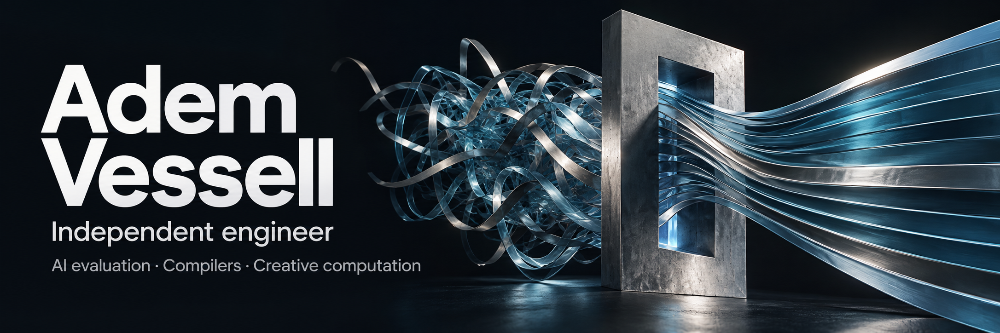

  <a href="https://www.xn--arkh-eva.org/about/">About me</a> ·
  <a href="https://www.xn--arkh-eva.org/reviews/">Work with me</a> ·
  <a href="https://x.com/AdemVessell">X</a>

I'm Adem, an independent engineer working on **AI evaluation, compiler correctness, and developer tools**. I also build interactive experiments in physics, graphics, and music.

I enjoy working out why software fails, then building a fix other people can use. My projects usually grow through experiments, tests, and review.

## Merged upstream contributions

**[NVIDIA SkillEvaluator](https://github.com/NVIDIA/SkillEvaluator/pull/63)**  
Added uncertainty estimates and paired-outcome reporting to help interpret agent-skill evaluations.

**[xDSL](https://github.com/xdslproject/xdsl/pulls?q=is%3Apr+is%3Amerged+author%3AAdemVessell)** · Six merged fixes  
Repaired silent wrong results in loop flattening, floating-point optimizations, and dynamic-shape interpretation, alongside loop-rewrite and LLVM-backend checks.

Explore the six xDSL changes

- [Preserve iteration counts when flattening loops](https://github.com/xdslproject/xdsl/pull/6437)
- [Keep positive and negative zero distinct during optimization](https://github.com/xdslproject/xdsl/pull/6434)
- [Preserve special values when folding division by zero](https://github.com/xdslproject/xdsl/pull/6435)
- [Use runtime shapes in the linalg interpreter](https://github.com/xdslproject/xdsl/pull/6444)
- [Require positive factors when folding loop ranges](https://github.com/xdslproject/xdsl/pull/6436)
- [Reject unsupported LLVM call operand bundles](https://github.com/xdslproject/xdsl/pull/6443)

Also contributed a [test fix to DESC](https://github.com/PlasmaControl/DESC/pull/2330), a stellarator optimization code.

**[CrocSwap / integer-mult-bounds #851](https://github.com/CrocSwap/integer-mult-bounds/pull/851)** · Research-verifier correctness
Hardened a verifier so incomplete or duplicate bridge-control evidence cannot pass. Added regression coverage while preserving valid reordered records and the selected mathematical result. Merged into `main` on 13 October 2026.

## Open proposals

11 authored upstream proposals were open when this profile was checked on 1 November 2026. [See their detailed status and current limits](https://www.xn--arkh-eva.org/work/#pending).

## Review work

**[Swift Foundation #2291](https://github.com/swiftlang/swift-foundation/pull/2291)** · Performance review
An access-order comparison exposed repeated eviction in a proposed Chinese-calendar cache. The author replaced the direct-mapped design with a three-entry LRU and added benchmarks. A bounded local recheck confirmed the selected collision was resolved at that revision; the PR remains open, and later source integration is outside that measurement result. [Author response](https://github.com/swiftlang/swift-foundation/pull/2291#issuecomment-6147308421)

## Tools and experiments

### AI PR Governor

A local CLI for checking repository state and pull-request evidence before acting on AI-generated code. It provides machine-readable decisions and queue planning. Currently a public alpha.

[Explore the tool](https://github.com/AdemVessell/ai-pr-governor)

<table>
<tr>
<td width="50%" valign="top">

<h3>Countercurrent</h3>

A playable WebGPU experiment in how a moving float and shallow water affect each other. Includes model notes and numerical checks.

<a href="https://www.xn--arkh-eva.org/countercurrent/">Try it</a> · <a href="https://github.com/AdemVessell/countercurrent">Source</a>

</td>
<td width="50%" valign="top">

<h3>Arkhē Lyric Lock</h3>

A local workflow for aligning lyrics to vocals, flagging uncertain timings, and repairing them in a browser.

<a href="https://github.com/AdemVessell/arkhe-lyric-lock">Source and video demos</a>

</td>
</tr>
</table>

### ARSENAL First Drop

Browser-native water and cloth experiments, built around interaction and documented tests. These are computational demonstrations with stated limits.

[Open the demos](https://ademvessell.github.io/arsenal-first-drop/) · [Source](https://github.com/AdemVessell/arsenal-first-drop)

## Working together

I'm interested in practical work on AI evaluation, software reliability, and developer workflows. My [website](https://www.xn--arkh-eva.org/work/) has more about the work and ways to get in touch.

I use AI tools in my workflow and document their role in individual projects. Reproducers, tests, and review feedback are part of what I share.
